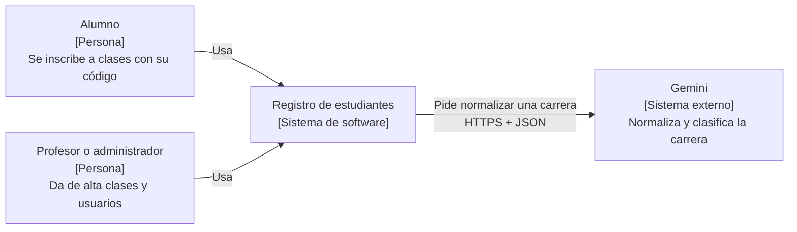
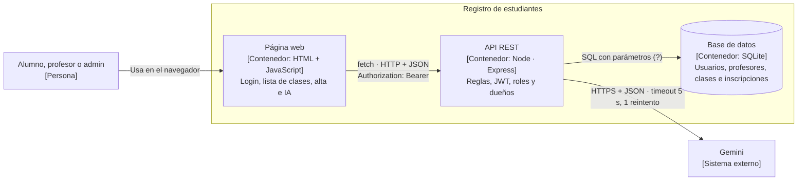

# Arquitectura

## Nivel 1 · Contexto

## Nivel 2 · Contenedores

Cada flecha es un mensaje por la red: eso es lo distribuido del sistema. La página corre en el navegador del usuario, la API en su propio proceso, la base de datos es un archivo que solo toca la API y Gemini vive en los servidores de Google.

## El recorrido de una petición

1. **Cliente:** la página (puerto 5500) manda `fetch` a la API (puerto 3000) con el token en `Authorization: Bearer`.
2. **CORS:** como son orígenes distintos, el navegador primero manda un `OPTIONS`; la API lo contesta con 204 antes de revisar el token.
3. **Autenticación:** `usuarioActual` verifica el JWT (401 si falta, está alterado o venció).
4. **Autorización:** `soloRoles` revisa el rol (403) y las consultas con dueño filtran por el usuario del token (404 si es ajeno).
5. **Validación:** `validarClase` revisa forma y rango de los datos (422).
6. **Endpoint y regla de negocio:** código repetido, ya inscrito o cupo lleno (409).
7. **Integración externa:** solo en `/estudiantes/carrera`, con tiempo máximo y errores 502/503/504.
8. **Persistencia:** SQLite con consultas parametrizadas.
9. **Respuesta:** JSON con su código; los errores siempre como `{"error", "detalles"}`.

## Qué pasa si algo falla

| Si falla... | Qué responde la API | Por qué |
|---|---|---|
| Gemini tarda más de 5 segundos | 504 | La API no se queda colgada: corta a los 5 s y el front muestra el aviso. |
| Gemini responde un error o algo que no es el JSON esperado | 502 | El problema es del otro servicio, no de la petición del usuario ni de nuestro código. |
| Gemini responde un error pasajero (429, 5xx) | Reintenta una vez; si vuelve a fallar, 502 | Un segundo intento suele bastar; reintentar más solo alarga la espera. |
| Falta `GEMINI_API_KEY` | 503 | El servicio no está configurado; el resto de la API sigue funcionando. |
| La página viene de un origen que no está en la lista | El navegador bloquea | CORS protege al usuario de páginas ajenas que quieran usar su sesión. |
| Se reinicia la API | Nada se pierde | Los datos están en SQLite, no en memoria. |
